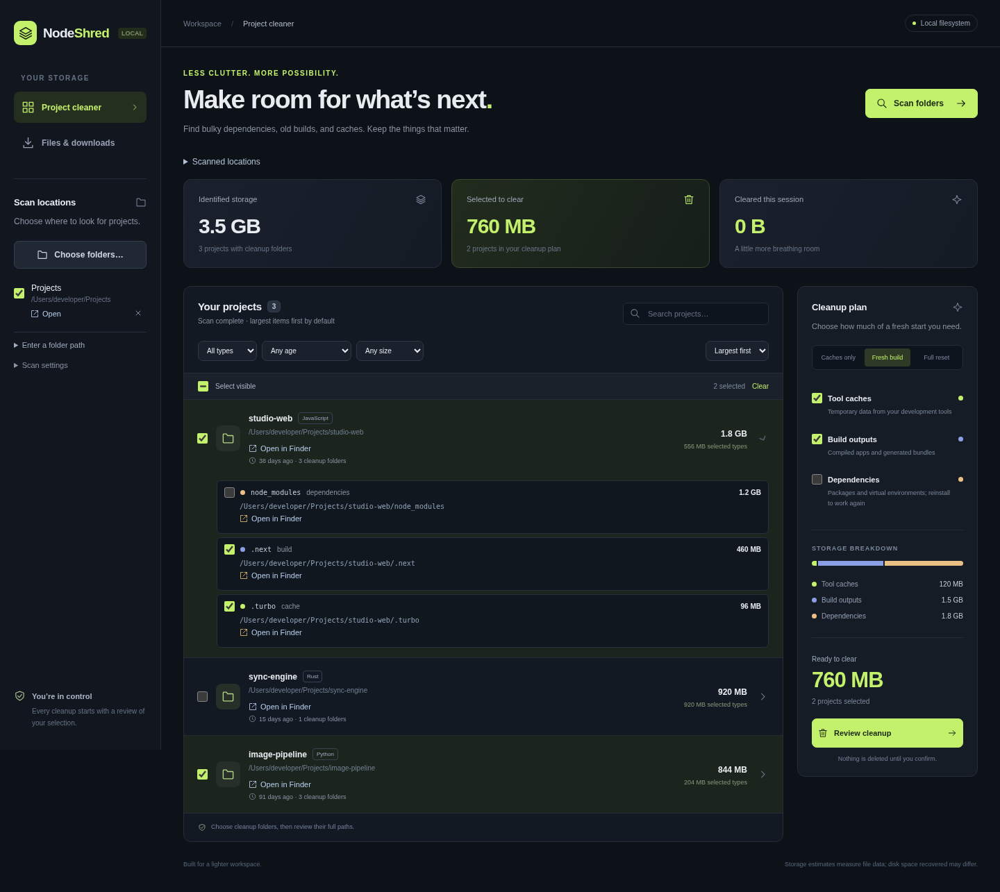
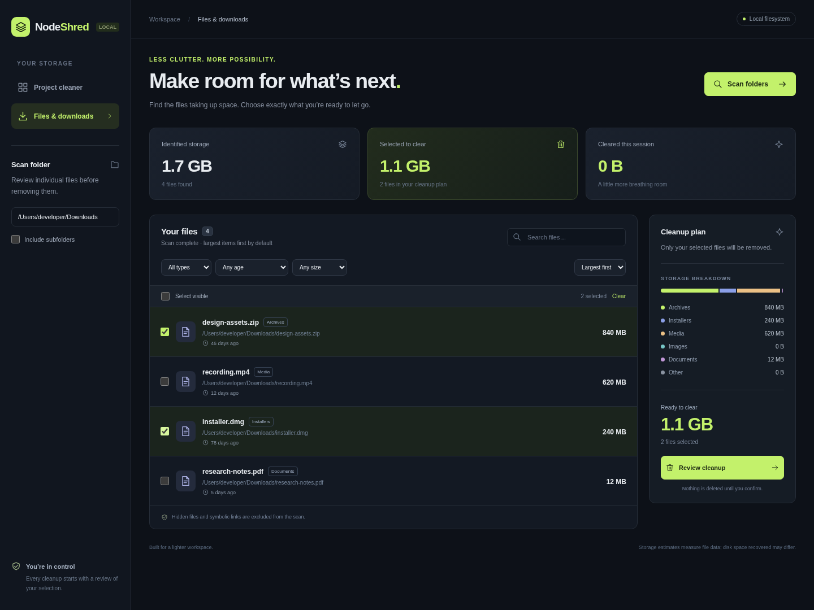
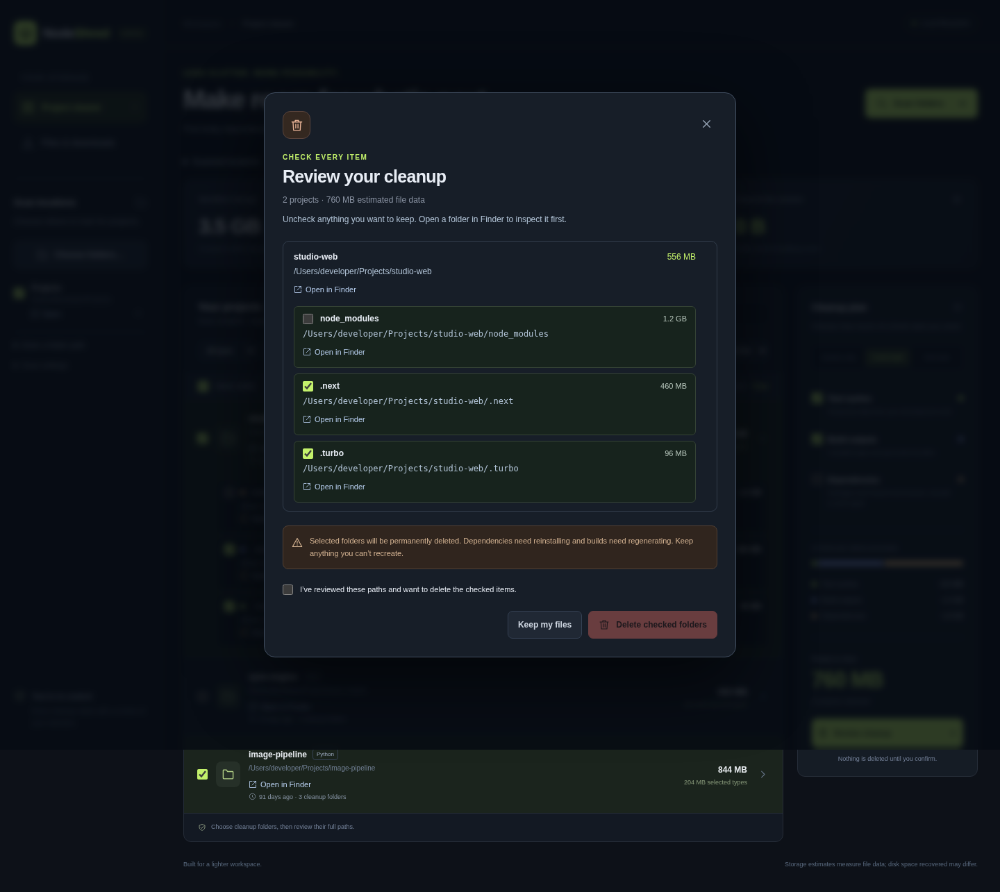

# NodeShred

NodeShred is a powerful desktop application built with Tauri and React that helps you reclaim disk space by cleaning up unused node_modules and build directories from your projects.



*Project cleaner with example projects, per-folder selection, and a storage breakdown.*



*Files & downloads with example archives, media, installers, and documents.*



*Full paths and selected folders are shown before confirming permanent deletion. Screenshots use demonstration data.*

## Features

- 🔍 Smart project detection across multiple drives
- 🧹 Selective cleanup of:
  - `node_modules` directories
  - Build directories (`dist`, `build`, `.next`, `out`)
  - Cache directories (`.cache`, `.parcel-cache`, `.webpack`)
- 📊 Visual size summaries and space savings
- 🔎 Project search and filtering
- ⏳ Age-based filtering (show projects older than X days)
- 💾 Multi-drive support
- 🖥️ Cross-platform (Windows, macOS, Linux)

## Installation

Download the latest release for your platform from the [Releases](https://github.com/kuldeepdhaka/node-shred/releases) page.

### Platform-Specific Notes

#### macOS

By default, macOS may prevent running applications from unidentified developers. To run NodeShred:

1. **First Launch**:
   - Right-click (or Control-click) the app
   - Select "Open" from the context menu
   - Click "Open" in the dialog

2. **Alternative Method** (if needed):
   ```bash
   # Enable apps from anywhere (use with caution)
   sudo spctl --master-disable
   
   # To revert this setting later:
   sudo spctl --master-enable
   ```

   Then:
   1. Go to System Preferences > Security & Privacy > General
   2. Click the lock to make changes
   3. Select "Allow apps downloaded from: Anywhere"

#### Linux

Ensure you have the required dependencies:
```bash
# Ubuntu/Debian
sudo apt-get install libwebkit2gtk-4.0-0 libgtk-3-0

# Fedora
sudo dnf install webkit2gtk3 gtk3

# Arch
sudo pacman -S webkit2gtk gtk3
```

## Development

### Prerequisites

- Node.js (v18 or later)
- Rust (latest stable)
- Bun (latest)

### Setup

1. Clone the repository:
   ```bash
   git clone https://github.com/kuldeepdhaka/node-shred.git
   cd node-shred
   ```

2. Install dependencies:
   ```bash
   bun install
   ```

3. Run in development mode:
   ```bash
   bun run tauri dev
   ```
   OR
   ```bash
   bunx tauri dev
   ```

### Building

To create a production build:
```bash
bun run tauri build
```

## Contributing

Contributions are welcome! Please feel free to submit a Pull Request.

## License

MIT License - see [LICENSE](LICENSE) for details.

## Security Note

NodeShred requires filesystem access to scan and clean up project directories. Always review the directories before deletion and ensure you have backups of important data.

## Selective storage cleanup

The project cleaner recognizes JavaScript (`package.json`), Python (`pyproject.toml`, `requirements.txt`, `setup.py`, or `Pipfile`), Rust (`Cargo.toml`), and PHP (`composer.json`) projects. Add folder paths in **Scan locations**, choose a scan depth, and scan. Generated dependency, build, and cache directories are skipped during project discovery, so packages inside dependencies do not appear as independent projects. Projects with only build output or caches are included.

Choose **Caches only**, **Fresh build** (caches and builds), or **Full reset** (also dependencies). Expand any project to override the preset with individual folders. Search, type, age, size, and sorting controls help narrow the list. **Select visible** applies only to the current filtered results; selections hidden by filters are counted explicitly. Storage estimates and the review list reflect the chosen folders, rather than the full project size. After cleanup, projects with remaining artifacts stay in the list.

Use **Files & downloads** to scan a specific folder and select individual archives, installers, media, images, documents, or other files. Subfolder scanning is opt-in, limited to 16 levels and 5,000 files. Hidden files, symbolic links, and dependency directories are excluded. Only files from the most recent file scan can be deleted, and files changed since the scan require another scan.

Cleanup requires a review of the full paths and an explicit confirmation. Deletion is permanent: items are **not moved to Trash**. Dependency folders need reinstalling, and build outputs need regenerating. Back up anything you need before cleanup. The native backend limits project cleanup to recognized artifact folders, validates all targets before starting, and rejects symbolic links and paths outside the project. Read failures and partial deletion errors are shown in the interface.

Sizes measure regular-file data without following links, rather than allocated filesystem blocks. Hard links, compression, files in use, and partial read failures can affect the disk space actually recovered. Age filters use project/artifact modification times or individual file modification times, not a claim about when a project was last used.

## Development checks

```bash
bun run test                     # Storage selection and filter tests
cargo test --locked --manifest-path src-tauri/Cargo.toml --lib
bun run build                    # TypeScript and production frontend build
cargo build --locked --manifest-path src-tauri/Cargo.toml

# Install the browser once, then run UI interaction tests.
bunx playwright install chromium
bun run test:ui
```

UI tests use a simulated Tauri bridge to exercise selection, confirmation, partial project retention, file cleanup, and responsive layouts. Native filesystem behavior is covered separately by the Rust tests. To use an installed Chromium instead of downloading a browser:

```bash
PLAYWRIGHT_CHROMIUM_EXECUTABLE_PATH=/usr/bin/chromium bun run test:ui
```

In the prepared cloud environment, activate the workspace-local toolchain with `source /workspace/.onboarding/node-shred/env.sh`. Desktop rendering needs the saved virtual-display and WebKit startup instructions. The browser view supports inspecting the interface; filesystem operations require the native desktop app.

### Install the upgraded app on macOS

From this checkout on your Mac, run:

```bash
bash scripts/install-macos.sh
```

The helper checks Apple Command Line Tools, installs missing Bun/Rust through Homebrew when available, builds the app for your Mac, and installs it in `~/Applications/NodeShred.app`. An existing app at that location is backed up before replacement. If Command Line Tools or prerequisites need manual installation, follow the printed instructions and rerun the helper. The macOS installer has been syntax-checked; the native macOS build still needs validation on a Mac.

## Automated release builds

Pushing to `release` runs the Release workflow: validation first, then macOS universal (Apple Silicon and Intel), Windows, and Linux DEB/AppImage builds. Installers are uploaded to a draft and published as a prerelease only after every platform succeeds. Branch builds use tags such as `preview-v0.2.0-<commit>`, so each build has its own download page. The same workflow can be run manually in GitHub Actions.

To publish a stable release, keep the versions in `package.json`, `src-tauri/Cargo.toml`, and `src-tauri/tauri.conf.json` aligned, then push a matching tag such as `v0.2.0`. macOS and Windows installers currently have no distribution signing certificates, and macOS builds are not notarized.
